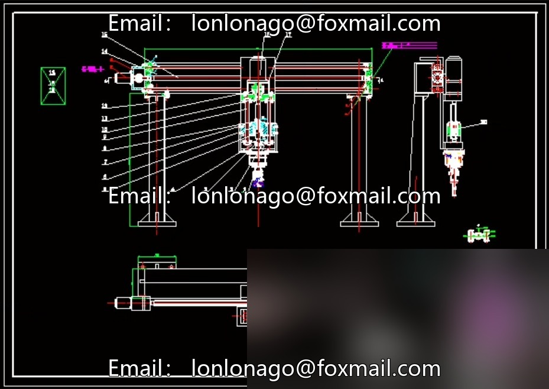
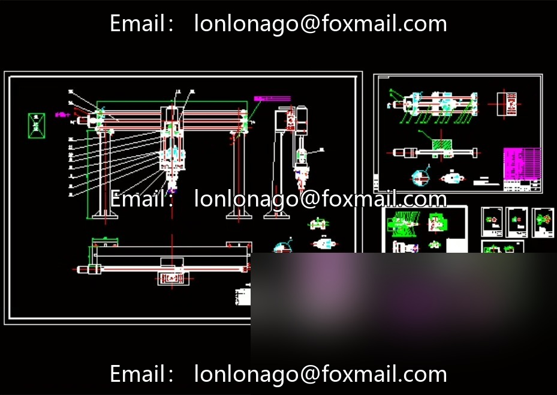

# Luge-type mechanical hand structural design Luge-type mechanical hand structural design diagram Luge-type mechanical hand structure design

## Body

Mechanical hand design structure; Mechanical hand design structure diagram; Mechanical hand design structure CAD diagram
127 This design presents specific mechanical hand design requirements and conducts overall scheme design and detailed structural design, calculations, and other works at each degree of freedom

The material includes gate-style robot structure design drawings, CAD sets, assembly drawings, design manuals, reports, and technical documents covering design requirements, overall scheme, degrees of freedom, transmission calculations, motor selection and structural parts.

<!-- AI_ENRICHED -->

## Images

## Payment

Here is a pay link on Stripe ( https://buy.stripe.com/3cs8yP7sY87d0vu9AB ). Please contact me lonlonago@foxmail.com after funding $89, and I will send you a complete data files , thank you!

